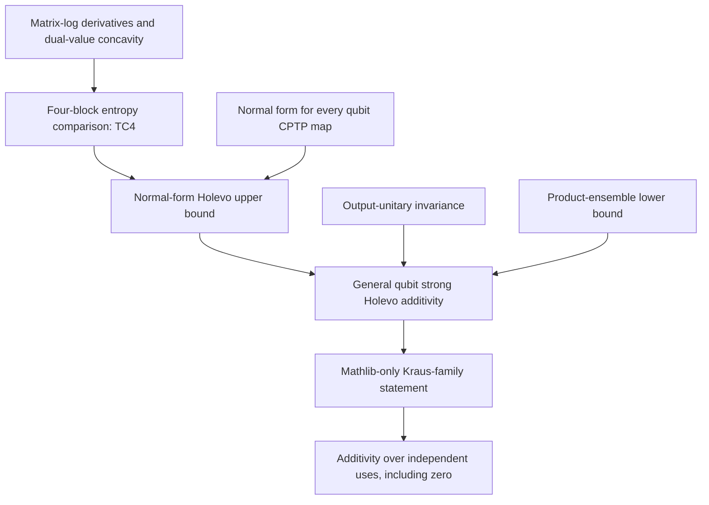

# Proof outline and entry points

The target is strong Holevo additivity when one factor is any channel from a
qubit to a qubit. The partner channel has arbitrary positive finite input and
output dimensions, and the joint ensemble may contain entangled signals.

1. **Entropy and the lower bound.** `Entropy`, `Ensemble` and `Holevo` establish
   the spectral entropy conventions, product-ensemble values and the product
   lower bound.
2. **Four-block comparison.** The beta modules prove a matrix-log variational
   comparison. They supply derivatives, positivity, minimizer existence and
   interior regularity, the value Hessian and concavity, extension to singular
   positive semidefinite inputs, rank-one decomposition and support compression.
   `BetaPositiveTC4` handles positive masses; `BetaTC4Regularization` and
   `BetaTC4Boundary` establish the original `TC4Bound`, including boundary cases.
3. **Channel reduction.** `NormalForm`, `NormalSchur`, `NormalCommonBranch`,
   `NormalKraus` and `NormalChannel` construct a complete normal form for an
   arbitrary qubit CPTP map after an output unitary rotation.
4. **The upper bound.** `TwoExpectation`, `Partner`, `PureInput`, `Marginal` and
   `UpperBound` turn the block comparison into explicit ensemble inequalities.
   Mixed inputs are reduced by spectral decomposition. Entropy subadditivity
   and concavity give the Holevo upper bound.
5. **Final theorem.** `RotationInvariant` transfers the result back through
   the output rotation. `GeneralResult.generalQubitStrongAdditivity` supplies
   the frozen original target; its upper-bound equivalent is also supplied.
6. **Public presentation.** `FCPresentation` identifies the Kraus-family
   vocabulary with the CPTP-map definitions. Its independent-use result follows
   by induction, including zero uses.

All paths above are modules under [`../lean/QubitAdditivity/`](../lean/QubitAdditivity/).
The [dependency ledger](../lean/blueprint/dependencies.json) records audited Lean
declarations as witnesses. Some intermediate lemmas are conditional; their
premises are discharged before the final theorem is assembled.

The historical rejected R2 shortcut is documented by
[`certificates/tc4_r2_certificate.json`](certificates/tc4_r2_certificate.json).
The [beta analysis note](notes/tc4-beta-audit.html) predates the completed Lean
proof. These are historical supporting documents, not additional assumptions.

